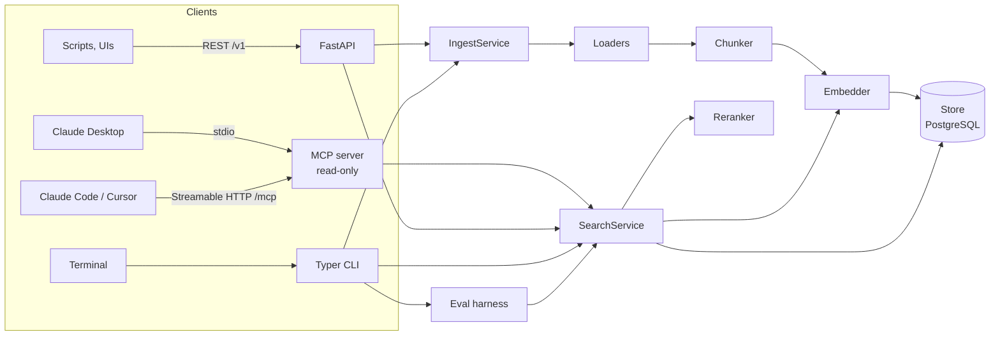
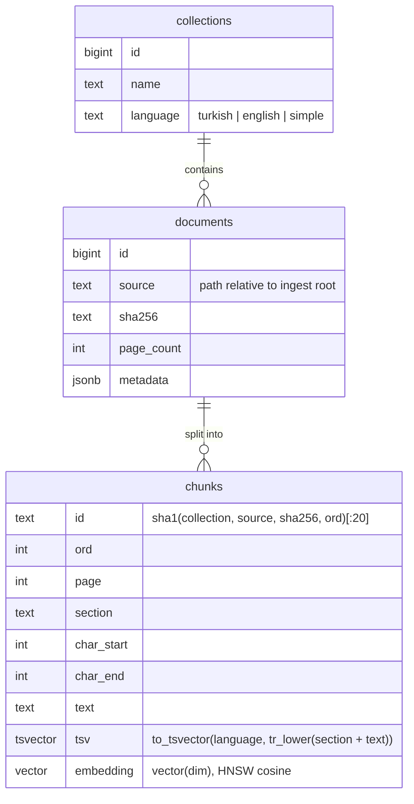

# Architecture

## Modules

| Module | Responsibility |
|---|---|
| `loaders` | File → `Page`s. PDF via pypdf (with line reflow), Markdown sections by heading path, text with form-feed pages, HTML, DOCX, and (in `extra_loaders`, standard library only) PPTX slides, XLSX sheets, CSV, EPUB chapters and EML messages. NFC normalisation, hyphenation repair, cp1254 fallback. |
| `chunking` | Sentence-ish units packed up to `chunk_size`, whole-sentence overlap, never across pages, offsets into the page text. |
| `embeddings` | `SentenceTransformerEmbedder` (bge-m3, e5 with prefixes) and `HashEmbedder` (tests). |
| `ingest` | Hash-based idempotency, contextual headers (title — section) for embedding, atomic replace. |
| `store` | SQL for collections, documents, chunks; `vector_search` (HNSW, cosine) and `keyword_search` (tsvector, OR query, `ts_rank_cd`). |
| `fusion` | Reciprocal Rank Fusion. |
| `search` | Mode selection, per-language keyword rankings, RRF, optional rerank, quote selection. |
| `mcp_server` / `api` / `cli` | Interfaces. |
| `evaluation` | Metrics and reports. |

## Data model

## Query pipeline

1. Resolve collections (default, explicit list, or `*`).
2. **Vector**: embed the query (e5: `query: ` prefix), `ORDER BY embedding <=> q LIMIT 40` with
   `hnsw.ef_search` raised and, on pgvector ≥ 0.8, `hnsw.iterative_scan = relaxed_order` so collection /
   source filters do not starve results.
3. **Keyword**: `to_tsvector(language, tr_lower(query))` → lexemes → `'a' | 'b' | 'c'` tsquery,
   ranked with `ts_rank_cd(…, 1)`; one ranking per language.
4. **Fuse** with RRF (k = 60). Per-retriever scores and ranks are kept in `hit.scores` for debugging.
5. **Rerank** (optional) the top 30 with the cross-encoder.
6. Fetch chunk records and pick the **best quote**: the sentence window of the chunk with the
   highest overlap of query stems, max 320 characters, verbatim.

## Design decisions

See the [ADRs](adr/index.md).
